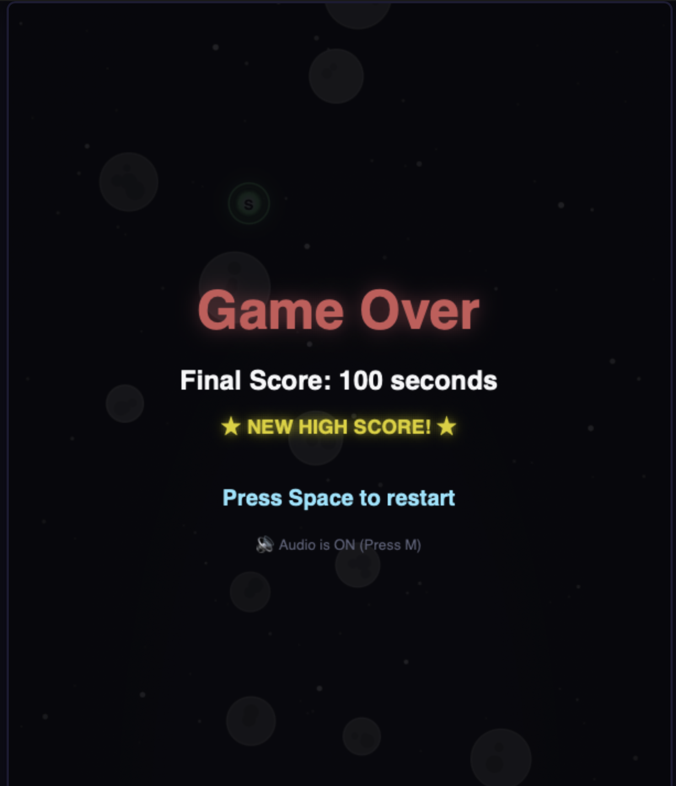

# ☄️ Meteor Dodge

A fast-paced, retro-arcade space survival game built entirely with vanilla HTML5 Canvas and zero external libraries.

---

## 🚀 Play it live

Give it a spin right in your browser:  
👉 **[https://prashantv32.github.io/meteor-dodge/](https://prashantv32.github.io/meteor-dodge/)**

---

## 🎮 Controls

Whether you're dodging on desktop or on your phone, controls are simple and responsive:

- **Desktop**: Use **Arrow Keys** (`←` / `→`) or **A / D** to steer your ship.
- **Mobile**: **Drag horizontally** anywhere on the screen to glide smoothly.
- **Start / Restart**: Press **Space** (or tap anywhere on screen).
- **Audio Mute**: Press **M** (or tap the `🔊` sound indicator in the top right).

---

## ✨ Features

- 🛡️ **Power-Up Orbs**:
  - **Green Shield Orb**: Grants a 5-second energy barrier that obliterates any meteor on contact!
  - **Blue Slow-Mo Orb**: Warps time and slows all falling asteroids down to 35% speed for 4 seconds.
- 📈 **Ramping Difficulty**: Every 10 seconds survived bumps you up a Hazard Tier — meteors drop faster and spawn in greater swarms.
- 🌌 **Parallax Starfield**: Multi-layer scrolling background with twinkling stars giving authentic deep space depth.
- 💥 **Explosion Physics**: Dynamic multi-colored particle bursts whenever you crash or smash through asteroids with a shield.
- 💾 **Local High Score**: Automatically saves your personal best survival record in `localStorage`.
- 🔊 **Synthesized Web Audio**: 100% pure procedural sound effects (power-up blips, shield zaps, and low explosion booms) with zero audio files downloaded.
- 📱 **Fully Responsive**: Scales cleanly to any screen size while locking in a classic 4:5 arcade aspect ratio.

---

## 🛠️ How this was made

> "I was trying the agy terminal agent and built this game in about 10 minutes (maybe less, IDK). My highest score is 100 seconds. Tell me what's yours!"

---

Enjoy dodging, and good luck beating 100 seconds! 🚀
